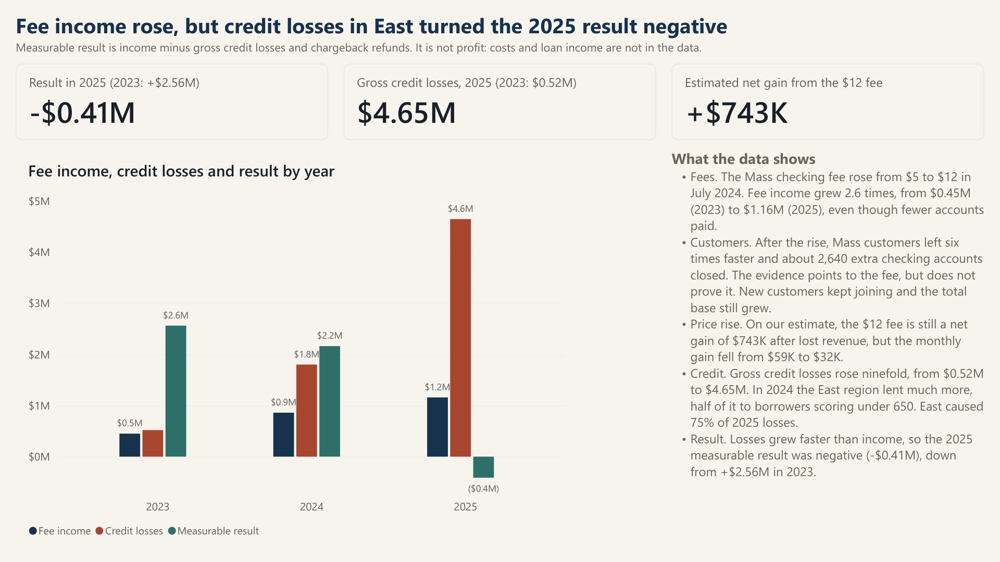
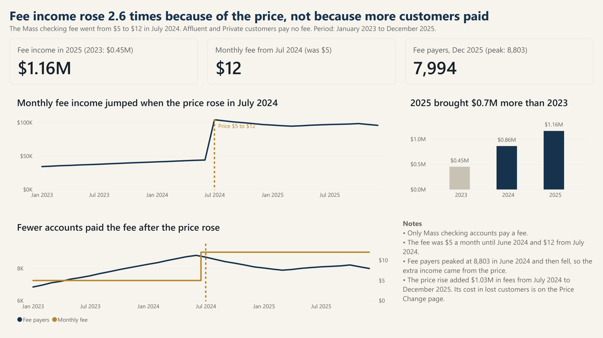
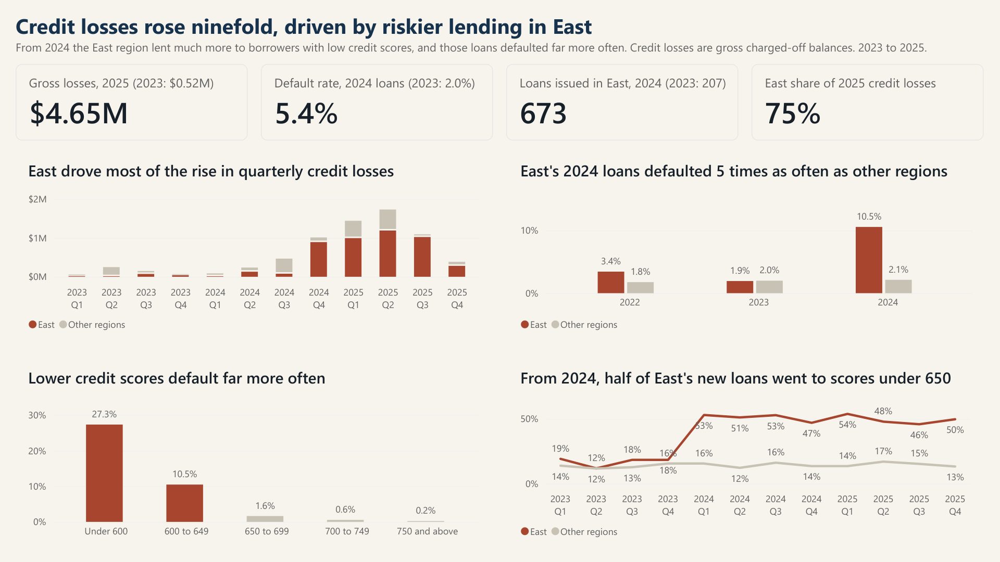
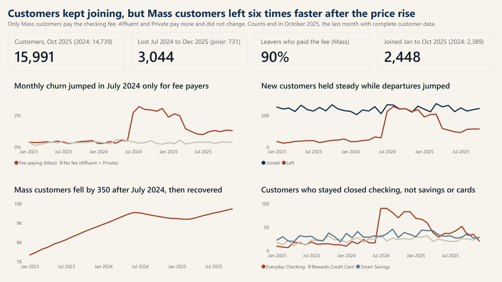
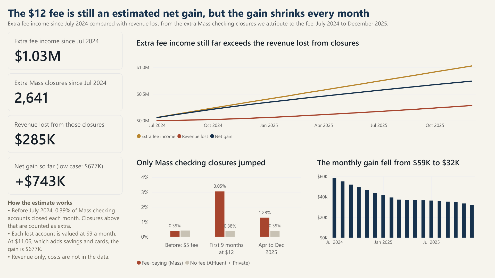
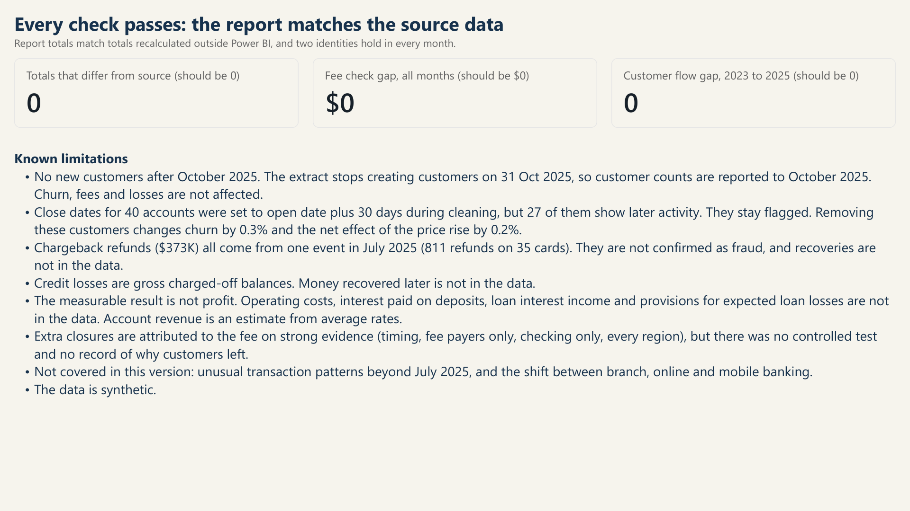

# Harborview Bank: 2025 Results Analysis in Power BI

An end-to-end analysis of a retail bank's 2023 to 2025 performance: data cleaning in Power Query, a star-schema model, DAX measures with reconciliation checks, a six-page Power BI report and a recommendations memo for the CFO.



The full report is also available as a [PDF](04_outputs/Dashboard.pdf).

## The business question

Leadership disagreed about 2025.

- The **Head of Retail** said it was the best year for fee income, thanks to the July 2024 rise in the monthly checking fee from $5 to $12.
- The **CFO** said overall results got worse, with customers leaving and credit losses rising.

The analysis tests both claims and recommends whether to keep the fee, and what to do about customers and credit risk in 2026.

## Key findings

1. **Fee income rose 2.6 times**, from $0.45M (2023) to $1.16M (2025). The rise came from the price, not from more customers: the number of accounts paying the fee fell from 8,803 to 7,994.
2. **The price rise very likely cost customers.** Mass checking closures went from 0.39% to 3.05% a month in the first nine months at $12, while customers who pay no fee stayed flat. The jump started in the week of the change, affected only checking and appeared in every region. About 2,640 more accounts closed than normal by December 2025. This is strong evidence, not proof: the bank did not record why customers left.
3. **The fee is still a net gain, but a shrinking one.** Extra fee income of $1.03M against an estimated $0.29M of lost revenue gives a net gain of about $743K so far. The monthly gain fell from $59K to $32K.
4. **The bank's measurable result fell from +$2.56M (2023) to -$0.41M (2025).** The cause is gross credit losses, which rose ninefold from $0.52M to $4.65M, not the fee.
5. **Three quarters of 2025 credit losses came from the East region.** From early 2024, all five East branches roughly tripled their lending and gave about half of it to borrowers scoring under 650. East's 2024 loans defaulted 10.5% of the time within a year, against 2.1% elsewhere, and $4.65M of East loans are still 30 or more days late.

**Verdict:** both leaders are partly right. Fee income did reach a record, and the base still grew overall, but credit losses in East turned the result negative.

## Recommendations

1. **Tighten credit approval in East now.** Bring the share of loans under 650 back to the 12 to 16% of other regions and review the late East loans one by one.
2. **Keep the $12 fee, but protect the Mass customer base.** Record why customers leave and test a fee waiver for active customers on a random group first.
3. **Investigate the July 2025 chargebacks and fix the data gaps.**

The full reasoning is in the [CFO memo](04_outputs/CFO_Memo.pdf).

## Report pages

| Page | Question it answers |
|---|---|
| Overview | What happened to income, losses and the overall result? |
| Fee Income | Did fee income rise, and was the price the reason? |
| Credit Risk | Where did the credit losses come from? |
| Customers | How did the customer base change, and who left? |
| Price Change | Did the $12 fee pay off after lost customers? |
| Data Checks | Do the report totals match the source data? |

### Fee Income



### Credit Risk



### Customers



### Price Change



### Data Checks



## Approach

**1. Scope.** Turned each leader's claim into neutral questions (an issue tree), defined 14 KPIs and wrote down hypotheses before looking at the data values. See [01_Scope_Document.md](02_documentation/01_Scope_Document.md).

**2. Data cleaning (Power Query).** Profiled every column on the full data set and fixed 19 problems across four tables, each logged with how it was found and how many rows it affected. Examples:
- 120 duplicate customers, 20 duplicate loans and 9,279 duplicate transactions
- dates in two formats in one column (a plain type change would have silently swapped day and month on 549 rows)
- interest rates stored as percentages instead of decimals, and placeholder credit scores of 0 and 999
- transactions dated after the extract date, and 150 transactions on accounts that do not exist

See [02_Data_Quality_Log.md](02_documentation/02_Data_Quality_Log.md).

**3. Data model.** A star schema with a marked Date table, single-direction relationships and an inactive relationship on the loan default date, switched on with `USERELATIONSHIP` in the loss measures. See [03_Data_Model.md](02_documentation/03_Data_Model.md).

**4. DAX measures.** Grouped into folders by topic, each with a description. They include month-end customer snapshots, churn and reactivation flows, a 12-month default rate by loan vintage, and a control-group estimate of the closures caused by the price change. See [04_KPI_Measure_Plan.md](02_documentation/04_KPI_Measure_Plan.md).

**5. Validation.** Every KPI was tested against totals calculated outside Power BI and against identities that must hold every month (fee income = paying accounts x average fee; customers at the end = start + new + returning - leavers). All checks return zero and are shown on the Data Checks page.

**6. Analysis and communication.** Findings, the hypothesis scorecard and the memo. See [05_Findings_Log.md](02_documentation/05_Findings_Log.md) and [06_Analysis.md](02_documentation/06_Analysis.md).

## Limitations

- **Not profit.** The data has no operating costs, deposit interest, loan interest income or loan-loss provisions, so the report uses a "measurable result" and never calls it profit.
- **Gross credit losses.** No recovery data, so losses are the full charged-off balances.
- **Cause.** The link between the fee and the extra closures rests on strong evidence, not a controlled test.
- **Chargebacks.** $373K of refunds in July 2025 are not confirmed as fraud.
- **Customer data ends in October 2025** for new customers, so customer counts are reported to that month.

## About the data

Harborview Bank is a fictional bank. The dataset is simulated, built to behave like the records of a mid-sized retail bank:

- about 20,000 customers, 36,600 accounts, 5,300 loans and 2.3 million transactions (2023 to 2025)
- realistic business patterns, such as a price change and the customer reaction to it, regional differences in lending and losses, and customers who leave and later return
- the kinds of data-quality problems found in real extracts, such as duplicates, mixed formats, wrong units and orphan keys

No real customer information is used.

## Repository structure

```
harborview_bank/
├── 01_raw_data/          source files as received (transactions is zipped)
├── 02_documentation/     brief, scope, data-quality log, model, measures, findings, analysis
├── 03_powerbi/           Harborview_Bank.pbix and a .pbit template
└── 04_outputs/           CFO memo, dashboard PDF and page screenshots
```

## How to open the report

1. Install [Power BI Desktop](https://www.microsoft.com/power-bi/desktop) (free, Windows).
2. Unzip `01_raw_data/transactions.zip` into the same folder.
3. Open `03_powerbi/Harborview_Bank.pbix`. If Power BI cannot find the data, go to Transform data > Data source settings and point each source to the files in `01_raw_data`.

The `.pbit` template holds the report and model without the data. It is small, and it loads the data again from the source files when opened.

## Tools

Power BI Desktop, Power Query (M), DAX.
